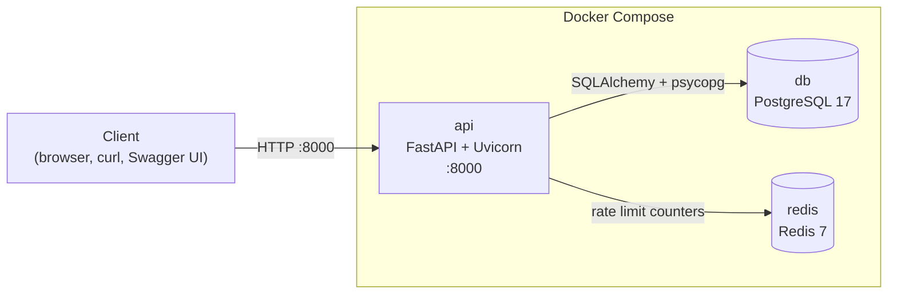
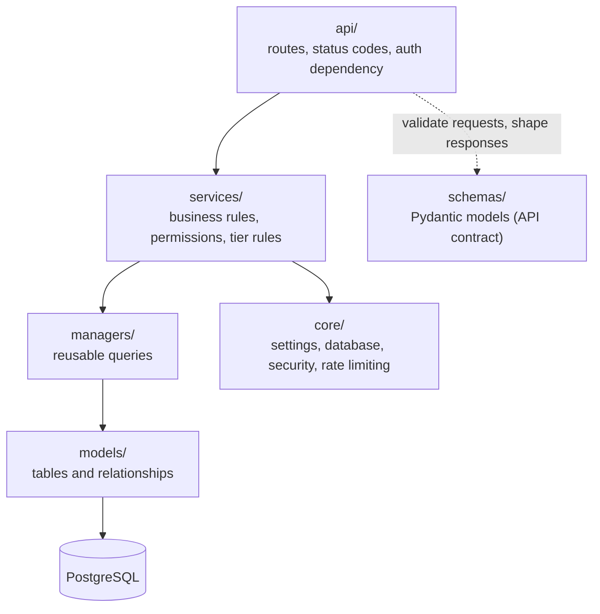
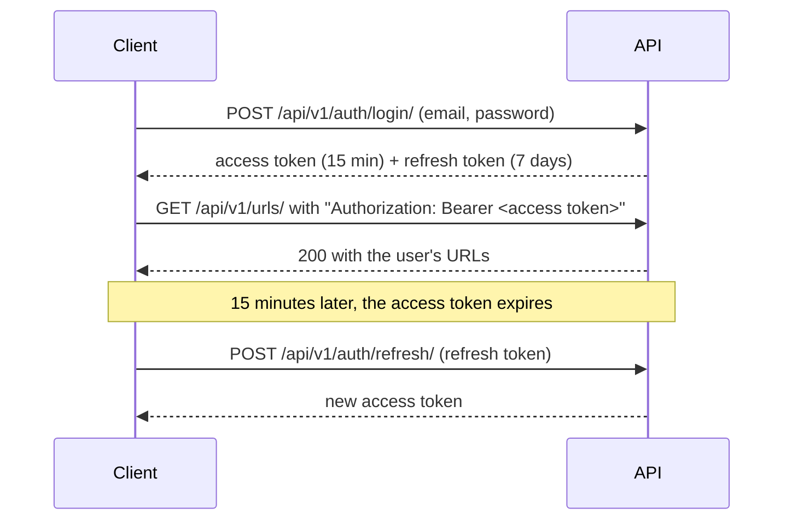
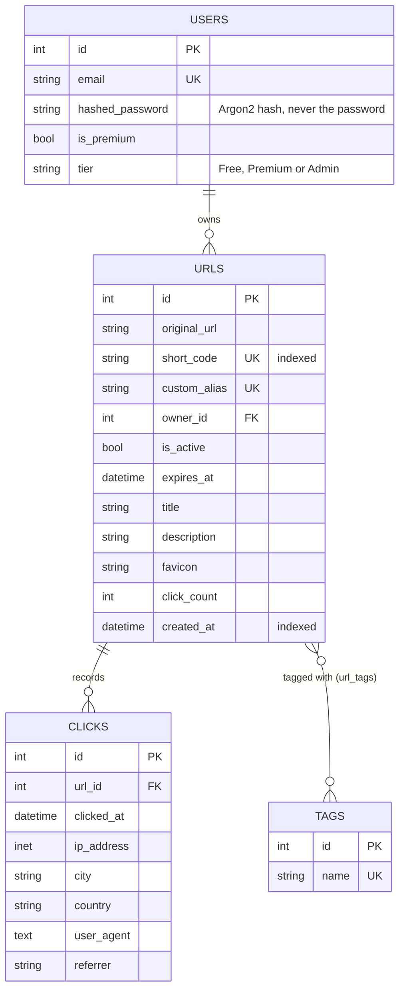

# URL Shortener Microservice

A URL shortening service (like Bitly or TinyURL) built with FastAPI, PostgreSQL and SQLAlchemy, and run with Docker Compose.

Users register, log in with JWT, create short codes for long URLs, organise them with tags, and every visit to a short link is recorded for analytics. Free and Premium tiers unlock different features, and login is rate limited.

## Tech Stack

| Category | Technology |
|---|---|
| Language | Python 3.12 |
| Framework | FastAPI |
| Database | PostgreSQL 17 |
| ORM and migrations | SQLAlchemy 2 and Alembic |
| Database driver | psycopg 3 |
| Authentication | JWT with PyJWT |
| Password hashing | Argon2 with pwdlib |
| Rate limiting | SlowAPI, with counters in Redis |
| Cache and counters | Redis 7 |
| Containerization | Docker and Docker Compose |
| Testing | pytest, against a real PostgreSQL database |
| API docs | OpenAPI (Swagger UI), generated by FastAPI |

The brief targets Django; this project meets the same requirements with FastAPI equivalents:

| Brief (Django) | This project |
|---|---|
| `AbstractUser` | `User` model with email, hashed password, `is_premium` and `tier` |
| Django migrations | Alembic migrations, including a data migration seeding default tags |
| Model managers | `URLManager` and `ClickManager` query builders |
| `select_related` / `prefetch_related` | `joinedload` / `selectinload` |
| `annotate()` aggregations | `GROUP BY` queries with `func.count` |
| `djangorestframework-simplejwt` | PyJWT access and refresh tokens |
| Django password hashing | Argon2 via pwdlib |
| DRF `IsOwnerOrReadOnly` | `get_current_user` dependency plus an ownership check in the services |
| DRF throttling | SlowAPI |

## Architecture



Inside the `api` service, each request passes through these layers, and each layer only calls the ones below it:



### Authentication flow



### Data model



Deleting a user deletes their URLs, and deleting a URL deletes its clicks (`ON DELETE CASCADE`).

## Project Structure

```
.
├── app/
│   ├── main.py                  # creates the app, registers routers and the rate limit handler
│   ├── core/                    # infrastructure used everywhere
│   │   ├── config.py            # settings, read once from the environment
│   │   ├── database.py          # engine and the per-request session
│   │   ├── security.py          # password hashing and JWT creation and verification
│   │   ├── rate_limit.py        # SlowAPI limiter and the 429 handler
│   │   └── cache.py             # Redis client (reserved for caching in Module 8)
│   ├── models/                  # database tables: user, url, click, tag
│   ├── schemas/                 # API contract: request and response models
│   │   ├── auth.py              # login and token schemas
│   │   ├── user.py              # registration and user responses
│   │   ├── url.py               # URL schemas and URL sanitization
│   │   ├── tag.py
│   │   └── analytics.py
│   ├── managers/                # reusable queries (URLManager, ClickManager)
│   ├── services/                # business rules
│   │   ├── auth.py              # register, login, refresh
│   │   ├── url.py               # URL rules and ownership checks
│   │   ├── tiers.py             # Free vs Premium rules
│   │   └── analytics.py
│   └── api/                     # HTTP layer
│       ├── deps.py              # SessionDep and CurrentUserDep
│       ├── redirect.py          # public GET /{short_code}/
│       └── v1/
│           ├── router.py        # groups all v1 routers under /api/v1
│           ├── auth.py
│           ├── urls.py
│           └── analytics.py
├── alembic/
│   └── versions/                # schema migrations and the default tags seed
├── tests/                       # pytest suite
├── alembic.ini
├── compose.yaml
├── Dockerfile
├── pyproject.toml
├── requirements.txt
├── .python-version
└── .env.example
```

## Setup

### Prerequisites

- Docker Desktop
- [uv](https://docs.astral.sh/uv/), only needed to run the app, migrations or tests outside Docker

### 1. Configure environment variables

```bash
cp .env.example .env
```

Then set a real `JWT_SECRET_KEY`. Generate one with:

```bash
uv run python -c "import secrets; print(secrets.token_urlsafe(32))"
```

| Variable | Required | Purpose |
|---|---|---|
| `POSTGRES_USER`, `POSTGRES_PASSWORD`, `POSTGRES_DB` | yes | Create the database user and database on the `db` container's first start |
| `DATABASE_URL` | yes | Connection string used when running outside Docker (`localhost:5433`) |
| `TEST_DATABASE_URL` | for tests | A separate database for the test suite; it is emptied after every test |
| `JWT_SECRET_KEY` | yes | Signs every token. Keep it secret and never commit it |
| `ACCESS_TOKEN_EXPIRE_MINUTES` | no | Access token lifetime (default `15`) |
| `REFRESH_TOKEN_EXPIRE_DAYS` | no | Refresh token lifetime (default `7`) |
| `RATE_LIMIT_STORAGE_URI` | no | Where rate limit counters live (default `memory://`; Docker uses Redis) |

Inside Docker, `compose.yaml` builds its own `DATABASE_URL` pointing at the `db` service and points rate limiting at the `redis` service, so those values in `.env` are only used when running on your machine.

Postgres only reads the `POSTGRES_*` values the first time its volume is created. If you change them later, reset the database with `docker compose down -v`.

### 2. Start the services

```bash
docker compose up --build -d
```

This starts `api` on port 8000, `db` (published on port 5433) and `redis`. The API waits until Postgres and Redis pass their health checks.

### 3. Run the migrations

```bash
docker compose exec api alembic upgrade head
```

This creates all tables and seeds the default tags: Marketing, Social, Personal, Work and News.

### 4. Create an account

Open [http://localhost:8000/docs](http://localhost:8000/docs) and call `POST /api/v1/auth/register/` with an email and a password of at least 8 characters. New accounts are on the Free tier.

To try Premium features, promote your account in the database (use your `.env` values):

```bash
docker compose exec db psql -U shortener -d url_shortener -c "UPDATE users SET tier = 'Premium', is_premium = true WHERE email = 'you@example.com';"
```

The tier is checked on every request, so existing tokens pick up the change immediately.

### 5. Authorize in Swagger

1. Call `POST /api/v1/auth/login/` and copy the `access_token` from the response.
2. Click **Authorize** at the top right of `/docs`, paste the token (without the word "Bearer") and confirm.
3. Swagger now sends the token with every request. Access tokens expire after 15 minutes; get a new one from `POST /api/v1/auth/refresh/` or log in again.

### Useful Docker commands

| Command | What it does |
|---|---|
| `docker compose up --build -d` | Build the image and start all services in the background |
| `docker compose ps` | Show container status and health |
| `docker compose logs -f api` | Follow the API logs |
| `docker compose exec api alembic upgrade head` | Apply migrations |
| `docker compose exec db psql -U shortener -d url_shortener` | Open a Postgres shell |
| `docker compose exec redis redis-cli keys "*"` | Inspect rate limit counters in Redis |
| `docker compose down` | Stop and remove containers, keeping the data |
| `docker compose down -v` | Stop and remove containers **and delete the database volume** |

Rebuild with `--build` whenever the code, migrations, dependencies or `Dockerfile` change: the image contains a copy of the code from when it was built.

### Running outside Docker

```bash
uv sync
docker compose up -d db redis    # only the database and Redis
uv run alembic upgrade head
uv run uvicorn app.main:app --reload
```

### Creating a new migration

After changing a model in `app/models/`:

```bash
uv run alembic revision --autogenerate -m "describe the change"
uv run alembic upgrade head
```

Always read the generated file before committing it.

### Running tests

Tests run against a separate PostgreSQL database, which is emptied after every test.

1. Create it once: `docker compose exec db createdb -U shortener url_shortener_test`
2. Set `TEST_DATABASE_URL` in `.env` (see `.env.example`).
3. Run: `uv run pytest`

The suite has 98 tests covering registration, login, token refresh, rate limiting, ownership rules, tier rules, URL sanitization, tag search, pagination, analytics, redirects, managers and database constraints.

## API Documentation

Base URL: `http://localhost:8000`. Interactive docs: [http://localhost:8000/docs](http://localhost:8000/docs).

Every endpoint except registration, login, refresh and the public redirect requires an access token:

```
Authorization: Bearer <access token>
```

### Endpoints

| Method | Endpoint | Auth | Description |
|---|---|---|---|
| `POST` | `/api/v1/auth/register/` | — | Create an account |
| `POST` | `/api/v1/auth/login/` | — | Log in and receive JWTs (5 attempts per minute) |
| `POST` | `/api/v1/auth/refresh/` | — | Exchange a refresh token for a new access token |
| `POST` | `/api/v1/urls/` | ✓ | Create a short URL |
| `GET` | `/api/v1/urls/` | ✓ | List your URLs (pagination and tag search) |
| `GET` | `/api/v1/urls/{short_code}/` | ✓ | Retrieve URL details (any logged-in user) |
| `PUT` | `/api/v1/urls/{short_code}/` | ✓ owner | Update a URL |
| `DELETE` | `/api/v1/urls/{short_code}/` | ✓ owner | Deactivate a URL |
| `GET` | `/api/v1/analytics/{short_code}/` | ✓ owner, Premium | Time-series and country analytics |
| `GET` | `/{short_code}/` | — | Public redirect to the original URL |

### Permissions and tiers

URL permissions follow **IsOwnerOrReadOnly**: any logged-in user may read a URL's details, but only its owner may update or deactivate it. Analytics are visible only to the owner.

| Feature | Free | Premium |
|---|---|---|
| Active URLs | Max 10 | Unlimited |
| Custom aliases | ❌ | ✅ |
| Detailed analytics | ❌ | ✅ |

Admins have Premium access. Deactivated and expired URLs do not count toward the Free limit, and reactivating a URL beyond the limit is refused.

### Errors

Errors are returned as `{"detail": "..."}`.

| Status | Meaning |
|---|---|
| `400` | Unknown tag names |
| `401` | Missing, invalid or expired token, or wrong login credentials |
| `403` | Not the owner, or the feature requires Premium, or the Free URL limit is reached |
| `404` | Short code not found (or, for the redirect, inactive or expired) |
| `409` | Email already registered, URL already shortened by you, or alias taken |
| `422` | Invalid input, including unsafe URLs |
| `429` | Too many login attempts; the `Retry-After` header says how long to wait |

---

### `POST /api/v1/auth/register/`

```json
{ "email": "you@example.com", "password": "at-least-8-chars" }
```

Returns `201`:

```json
{ "id": 1, "email": "you@example.com", "tier": "Free", "is_premium": false }
```

Emails are case-insensitive. The password is stored only as an Argon2 hash and is never returned.

### `POST /api/v1/auth/login/`

```json
{ "email": "you@example.com", "password": "at-least-8-chars" }
```

Returns `200`:

```json
{ "access_token": "eyJ...", "refresh_token": "eyJ...", "token_type": "bearer" }
```

A wrong password and an unknown email return the same `401` message, so the endpoint never reveals which emails have accounts. Limited to 5 attempts per minute per IP address.

### `POST /api/v1/auth/refresh/`

```json
{ "refresh_token": "eyJ..." }
```

Returns `200`:

```json
{ "access_token": "eyJ...", "token_type": "bearer" }
```

Access tokens cannot be used here, and refresh tokens cannot be used to call the API.

### URL object

Endpoints that return a URL use this shape:

```json
{
  "short_code": "aZ3kP9q",
  "original_url": "https://example.com/some/long/page",
  "custom_alias": null,
  "is_active": true,
  "expires_at": null,
  "title": "Example page",
  "description": null,
  "favicon": null,
  "click_count": 12,
  "created_at": "2026-11-15T10:37:01Z",
  "owner": { "id": 1, "email": "you@example.com" },
  "tags": [{ "name": "Marketing" }]
}
```

### `POST /api/v1/urls/`

```json
{
  "original_url": "https://example.com/some/long/page",
  "custom_alias": "my-link",
  "title": "Example page",
  "description": "Optional description",
  "expires_at": "2026-12-31T23:59:59Z",
  "tags": ["Marketing", "Social"]
}
```

Only `original_url` is required. The owner is always the logged-in user.

- `custom_alias` (Premium only): 3 to 10 characters (letters, digits, `-`, `_`). It becomes the short code; otherwise a random 7-character code is generated.
- `tags`: names of existing tags.
- Every URL is sanitized: only `http` and `https` are accepted, at most 2048 characters, with no embedded username or password, and no localhost or private network addresses. Surrounding whitespace is trimmed from all text fields.

Returns `201` with the URL object.

### `GET /api/v1/urls/`

| Parameter | Default | Rules |
|---|---|---|
| `page` | `1` | at least 1 |
| `size` | `10` | between 1 and 100 |
| `tag` | — | only URLs with this tag, case-insensitive |

Lists your own URLs, newest first. Example: `GET /api/v1/urls/?tag=Marketing&page=2&size=10`

```json
{ "items": [ "...URL objects..." ], "total": 25, "page": 2, "size": 10 }
```

`total` counts the URLs matching the filter, so clients can compute the number of pages.

### `GET /api/v1/urls/{short_code}/`

Returns the URL object. Any logged-in user may read any URL.

### `PUT /api/v1/urls/{short_code}/`

Send only the fields to change:

```json
{ "title": "New title", "is_active": true, "tags": ["Work"] }
```

Updatable fields: `original_url`, `title`, `description`, `expires_at`, `is_active`, `tags` (replaces the URL's tags). Owner only.

### `DELETE /api/v1/urls/{short_code}/`

Deactivates the URL (`is_active = false`) instead of deleting it, so its click history is kept. It stops redirecting immediately and can be reactivated with `PUT`. Owner only. Returns `204`.

### `GET /api/v1/analytics/{short_code}/`

Owner and Premium only. Returns `200`:

```json
{
  "short_code": "aZ3kP9q",
  "total_clicks": 3,
  "clicks_per_day": [
    { "day": "2026-11-01", "total_clicks": 2 },
    { "day": "2026-11-02", "total_clicks": 1 }
  ],
  "clicks_per_country": [
    { "country": "Rwanda", "total_clicks": 2 },
    { "country": null, "total_clicks": 1 }
  ]
}
```

All counting is done in SQL. `country` is `null` when the visitor's location is unknown; IP geolocation is not part of this module yet.

### `GET /{short_code}/`

Public. Redirects with `302 Found` to the original URL and records a click (IP address, user agent, referrer). Only active, non-expired URLs redirect.

`302` is used instead of `301` because browsers cache `301` redirects permanently, which would skip the server on later visits: those clicks would not be recorded, and deactivating a link would not take effect for people who had already visited it.

## Security

- **Passwords** are hashed with Argon2 (salted and deliberately slow). Only the hash is stored, and it is never returned by the API.
- **JWTs** are signed with `JWT_SECRET_KEY`. Access tokens last 15 minutes; refresh tokens last 7 days and can only be used to get new access tokens. Tokens for deleted users are rejected.
- **Login** returns the same error for unknown emails and wrong passwords, and is limited to 5 attempts per minute per IP address. Counters are stored in Redis, so they are shared by all processes and survive restarts.
- **Authorization** is checked on every request: ownership for updates, deletes and analytics, and tier rules for Premium features.
- **Input sanitization:** URLs are restricted to `http` and `https`, limited in length, and rejected if they contain credentials or point to localhost or private networks. Text fields are trimmed and length-limited.

## Design Decisions

- **Short codes** are 7 random characters from `[A-Za-z0-9]`, generated with Python's `secrets` module so they cannot be predicted.
- **Layered structure:** endpoints handle HTTP only, services hold the business rules, managers hold reusable queries, and schemas define the API contract.
- **N+1 prevention:** list and detail queries load each URL's owner with a `JOIN` (`joinedload`) and its tags with one extra `IN` query (`selectinload`), so a page of URLs always costs a fixed number of queries.
- **Analytics in SQL:** click counts per country and per day are computed with `GROUP BY` in PostgreSQL rather than in Python.
- **Atomic click counting:** the redirect increments `click_count` with `UPDATE ... SET click_count = click_count + 1`, so simultaneous clicks are never lost.
- **Tier limit check:** a new or reactivated URL is written inside the transaction, the user's active URLs are counted, and the change is rolled back if a Free user would exceed 10. One check covers creating, reactivating and extending expiry.
- **Tag search** uses `EXISTS`, so a URL with several tags appears only once.
- **Pagination:** offset based (`page` and `size`), with a stable `created_at, id` ordering so pages never overlap.
- **Synchronous endpoints:** the app uses synchronous SQLAlchemy, so endpoints are plain `def` functions, which FastAPI runs in a thread pool instead of blocking the event loop.

## Roadmap

| Module | Focus | Status |
|---|---|---|
| 5 | Foundational architecture and Docker | Done |
| 6 | Data models, migrations, managers, query optimization | Done |
| 7 | JWT authentication, role-based access, rate limiting | Done |
| 8 | Redis caching of redirects, Celery background tasks for analytics | Planned |
| 9 | URL preview service, QA, documentation | Planned |