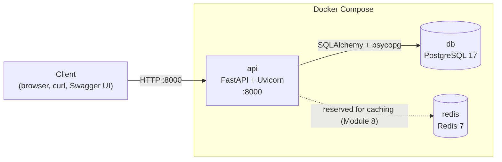
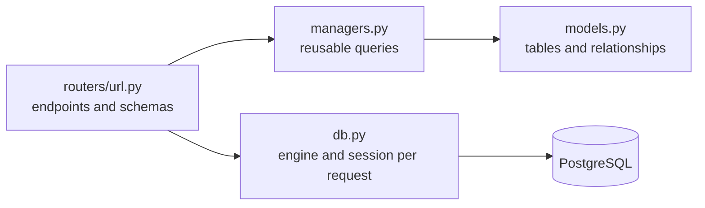
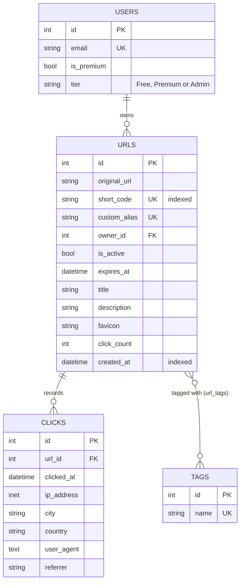

# URL Shortener Microservice

A URL shortening service (like Bitly or TinyURL) built with FastAPI, PostgreSQL and SQLAlchemy, and run with Docker Compose.

Users create short codes for long URLs, organise them with tags, and every visit to a short link is recorded for analytics.

## Tech Stack

| Category | Technology |
|---|---|
| Language | Python 3.12 |
| Framework | FastAPI |
| Database | PostgreSQL 17 |
| ORM and migrations | SQLAlchemy 2 and Alembic |
| Database driver | psycopg 3 |
| Cache (planned, Module 8) | Redis 7 |
| Containerization | Docker and Docker Compose |
| API docs | OpenAPI (Swagger UI), generated by FastAPI |

## Architecture



Inside the `api` service, a request flows through these layers:



### Data model



Deleting a user deletes their URLs, and deleting a URL deletes its clicks (`ON DELETE CASCADE`).

## Project Structure

```
.
├── app/
│   ├── main.py            # creates the FastAPI app and includes the routers
│   ├── db.py              # SQLAlchemy engine and the get_db session dependency
│   ├── models.py          # User, URL, Click, Tag models and the url_tags table
│   ├── managers.py        # URLManager and ClickManager query helpers
│   ├── dependency.py      # Redis client (reserved for caching in Module 8)
│   └── routers/
│       └── url.py         # URL CRUD endpoints and the public redirect
├── alembic/
│   └── versions/          # migrations, including the default tags seed
├── tests/
├── alembic.ini
├── compose.yaml
├── Dockerfile
├── requirements.txt
├── pyproject.toml
└── .env.example
```

## Setup

### Prerequisites

- Docker Desktop
- [uv](https://docs.astral.sh/uv/), only needed to run the app or tests outside Docker

### 1. Configure environment variables

Copy the example file and adjust the values if you like:

```bash
cp .env.example .env
```

| Variable | Used by | Purpose |
|---|---|---|
| `POSTGRES_USER`, `POSTGRES_PASSWORD`, `POSTGRES_DB` | `db` container | Create the database user and database on first start |
| `DATABASE_URL` | the app and Alembic when run outside Docker | Connection string pointing at `localhost:5433` |

Inside Docker, `compose.yaml` builds its own `DATABASE_URL` that points at the `db` service, so the value in `.env` is only used when running on your machine.

Postgres only reads the `POSTGRES_*` values the first time its volume is created. If you change them later, reset the database with `docker compose down -v`.

### 2. Start the services

```bash
docker compose up --build -d
```

This starts three containers: `api` on port 8000, `db` (published on port 5433), and `redis`. The API waits until Postgres and Redis pass their health checks.

### 3. Run the migrations

```bash
docker compose exec api alembic upgrade head
```

This creates all tables and seeds the default tags: Marketing, Social, Personal, Work and News.

### 4. Create a user

Authentication arrives in Module 7. Until then, insert a user directly (use your `.env` values):

```bash
docker compose exec db psql -U shortener -d url_shortener -c "INSERT INTO users (email, is_premium, tier) VALUES ('test@example.com', false, 'Free');"
```

### 5. Open the API docs

Visit [http://localhost:8000/docs](http://localhost:8000/docs) to explore and call every endpoint from the browser.

### Useful Docker commands

| Command | What it does |
|---|---|
| `docker compose up --build -d` | Build the image and start all services in the background |
| `docker compose ps` | Show container status and health |
| `docker compose logs -f api` | Follow the API logs |
| `docker compose exec api alembic upgrade head` | Apply migrations |
| `docker compose exec db psql -U shortener -d url_shortener` | Open a Postgres shell |
| `docker compose down` | Stop and remove containers, keeping the data |
| `docker compose down -v` | Stop and remove containers **and delete the database volume** |

### Running outside Docker

```bash
uv sync
docker compose up -d db          # only the database
uv run alembic upgrade head
uv run uvicorn app.main:app --reload
```

### Creating a new migration

After changing `app/models.py`:

```bash
uv run alembic revision --autogenerate -m "describe the change"
uv run alembic upgrade head
```

Always read the generated file before committing it.

### Running tests

```bash
uv run pytest
```

## API Documentation

Base URL: `http://localhost:8000`

Authentication is not part of this module, so requests identify the user with an `owner_id`: in the JSON body for `POST` and `PUT`, and as a query parameter for `GET` and `DELETE`. A user can only see and change their own URLs; requesting someone else's URL returns `404`.

### Endpoints

| Method | Endpoint | Description |
|---|---|---|
| `POST` | `/api/v1/urls/` | Create a short URL |
| `GET` | `/api/v1/urls/?owner_id=` | List a user's URLs (paginated) |
| `GET` | `/api/v1/urls/{short_code}/?owner_id=` | Retrieve URL details |
| `PUT` | `/api/v1/urls/{short_code}/` | Update a URL |
| `DELETE` | `/api/v1/urls/{short_code}/?owner_id=` | Deactivate a URL |
| `GET` | `/{short_code}/` | Public redirect to the original URL |

### URL object

Every endpoint that returns a URL uses this shape:

```json
{
  "short_code": "aZ3kP9q",
  "original_url": "https://example.com/some/long/page",
  "custom_alias": null,
  "is_active": true,
  "expires_at": null,
  "title": "Example page",
  "description": null,
  "favicon": null,
  "click_count": 12,
  "created_at": "2026-11-15T10:37:01Z",
  "owner": { "id": 1, "email": "test@example.com" },
  "tags": [{ "name": "Marketing" }]
}
```

### `POST /api/v1/urls/` — Create a short URL

Request body:

```json
{
  "original_url": "https://example.com/some/long/page",
  "owner_id": 1,
  "custom_alias": "my-link",
  "title": "Example page",
  "description": "Optional description",
  "expires_at": "2026-12-31T23:59:59Z",
  "tags": ["Marketing", "Social"]
}
```

Only `original_url` and `owner_id` are required.

- `custom_alias`: 3 to 10 characters (letters, digits, `-`, `_`). When given, it becomes the short code; otherwise a random 7-character code is generated.
- `tags`: names of existing tags.

Responses: `201` with the URL object, `400` unknown tag, `404` user not found, `409` URL already shortened by this user or alias taken, `422` invalid input.

### `GET /api/v1/urls/` — List a user's URLs

Query parameters:

| Parameter | Required | Default | Rules |
|---|---|---|---|
| `owner_id` | yes | — | integer |
| `page` | no | `1` | at least 1 |
| `size` | no | `10` | between 1 and 100 |

Results are ordered newest first. Example: `GET /api/v1/urls/?owner_id=1&page=2&size=10`

```json
{
  "items": [ "...URL objects..." ],
  "total": 25,
  "page": 2,
  "size": 10
}
```

`total` is the number of URLs the user has, so clients can compute the number of pages.

### `GET /api/v1/urls/{short_code}/` — Retrieve URL details

Example: `GET /api/v1/urls/aZ3kP9q/?owner_id=1`

Responses: `200` with the URL object, `404` not found or not owned by this user.

### `PUT /api/v1/urls/{short_code}/` — Update a URL

Send `owner_id` plus only the fields you want to change:

```json
{
  "owner_id": 1,
  "title": "New title",
  "is_active": true,
  "tags": ["Work"]
}
```

Updatable fields: `original_url`, `title`, `description`, `expires_at`, `is_active`, `tags` (replaces the URL's tags). Fields you leave out are unchanged.

Responses: `200` with the updated URL object, `400` unknown tag, `404` not found, `422` invalid input.

### `DELETE /api/v1/urls/{short_code}/` — Deactivate a URL

Example: `DELETE /api/v1/urls/aZ3kP9q/?owner_id=1`

The URL is deactivated (`is_active = false`) rather than deleted, so its click history is kept. It stops redirecting immediately and can be reactivated with `PUT`.

Responses: `204` no content, `404` not found.

### `GET /{short_code}/` — Redirect

Example: `GET /aZ3kP9q/`

Redirects with `302 Found` to the original URL and records a click (IP address, user agent, referrer). Only active, non-expired URLs redirect.

`302` is used instead of `301` because browsers cache `301` redirects permanently, which would skip the server on later visits: those clicks would not be recorded, and deactivating a link would not take effect for people who had already visited it.

Responses: `302` redirect, `404` not found, inactive or expired.

## Design Decisions

- **Short codes** are 7 random characters from `[A-Za-z0-9]`, generated with Python's `secrets` module so they cannot be predicted.
- **N+1 prevention:** list and detail queries load each URL's owner with a `JOIN` (`joinedload`) and its tags with one extra `IN` query (`selectinload`), so a page of URLs always costs a fixed number of queries.
- **Analytics in SQL:** click counts per country and per day are computed with `GROUP BY` in PostgreSQL rather than in Python.
- **Atomic click counting:** the redirect increments `click_count` with `UPDATE ... SET click_count = click_count + 1`, so simultaneous clicks are never lost.
- **Pagination:** offset based (`page` and `size`), with a stable `created_at, id` ordering so pages never overlap.

## Roadmap

| Module | Focus | Status |
|---|---|---|
| 5 | Foundational architecture and Docker | Done |
| 6 | Data models, migrations, managers, query optimization | Done |
| 7 | JWT authentication, role-based access, rate limiting | Planned |
| 8 | Redis caching, Celery background tasks | Planned |
| 9 | URL preview service, QA, documentation | Planned |